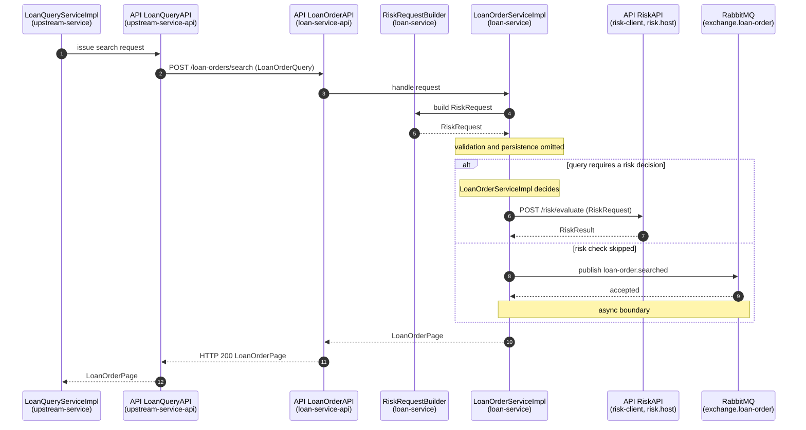

# Flow Chart

## Requirement

The diagram is one Mermaid `sequenceDiagram` and an integration view of the real call chain. Show only:

- Service APIs: REST API, Feign or RPC client, message listener, or broker topic or queue.
- Code that builds or enriches an outbound request, chooses a target API, publishes a message, or invokes an API client.

Leave out controllers that only delegate, validation-only helpers, mappers, repositories, entity services, DTO converters, and local persistence or account side effects.

When the task names an endpoint, that method and path stay exact. A known path such as `/loan-orders/search` is never replaced with a generic label such as `Query API`.

When the entry point is an API, the diagram uses a real upstream caller. `Client` is allowed only when no caller is found or caller lookup is out of scope.

If source does not implement a branch the task describes, do not draw the desired behavior as if it exists. Add a short `Note over` for the gap, or omit the branch.

## Process

Recover the chain with `rg` and direct file reads. Use a call-graph tool only when one is already available.

1. Find the entry point in source.
2. When the entry point is an API, search inbound cross-service callers, Feign or RPC clients that extend or wrap the API, and literal path or method matches before using `Client`.
3. Follow callers and callees until every external HTTP, RPC, and MQ hop is known.
4. Keep the participants named in Requirement and drop the rest.
5. Render the compressed diagram with the Style below.

## Style

- Start with `autonumber`.
- One participant line: `participant Alias as ClassName (service)`. Add a host only for a remote API: `ClassName (module, host)`.
- Group each service as its API participant, then that service's internal participants. Put a blank line between groups.
- Mark an API participant by prefixing the label with `API`: `participant SearchApi as API LoanOrderAPI (loan-service-api)`. Do not use `box` or color styling.
- A found upstream caller appears before the target service. The named endpoint is the first message into that service, and its label is the exact method and path, for example `POST /loan-orders/search`.
- Other HTTP messages include method and path. Return messages name the result type or status.
- Use `->>` and `-->>`. Use `->>+` / `-->>-` only when each activation closes inside the same `alt` branch.
- Use `alt` / `else` / `end` only when the branch changes an outbound API call, a published message, or the returned result. Add `Note over` naming the deciding code.
- Model MQ and other async handoffs as a broker participant plus one boundary `Note over`.
- Mention omitted internals in one `Note over`, not as extra participants.

## Verification

Before returning the diagram, confirm:

- The named endpoint appears verbatim as method and path on the first message into that service.
- A real upstream caller was searched; `Client` is used only if none was found or lookup was out of scope.
- Every participant is a service API or code that builds a request, publishes a message, or calls an API.
- `alt` branches change an outbound call, a message, or the result.
- API labels use the `API` prefix. There is no `box` and no color styling.
- `autonumber` is present, and any activation closes inside the same branch.
- Unimplemented behavior is a note or is omitted.
