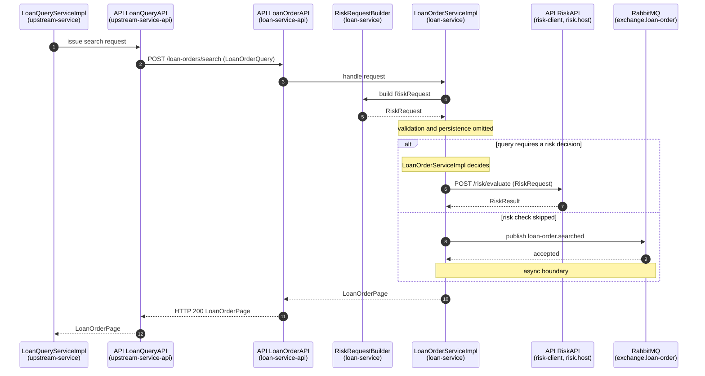
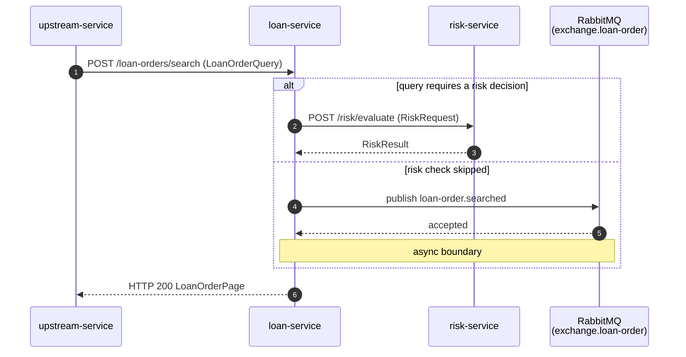

# Flow Chart

## Detail level

Ask the user which detail level to use before tracing code or drawing. Use the AskQuestion tool. Do not draw until the user answers. If the request already names High Level, Medium Level, or Low Level, use that level and do not ask again.

- **High Level**: Only interactions between running applications and MQ
- **Medium Level**: service level interactions and important steps in each service
- **Low Level**: service level interactions and each step in each service

### High Level

Participants are running applications and MQ only. A running application is a deployed process, such as `loan-service`, not an API module, client library, or class. Messages are cross-application HTTP, RPC, and MQ calls. Collapse every step inside an application into that application. Do not add API interfaces, internal classes, or any participant that is not a running application or MQ.

### Medium Level

Service APIs, plus the important steps inside each service: code that builds or enriches an outbound request, chooses a target API, publishes a message, or invokes an API client.

Leave out controllers that only delegate, validation-only helpers, mappers, repositories, entity services, DTO converters, and local persistence or account side effects.

### Low Level

Service APIs, plus each step inside each service. Include controllers, validation, mapping, repositories, entity services, converters, and persistence when they sit on the call chain. One message per call. Do not merge steps.

## Requirement

The diagram is one Mermaid `sequenceDiagram` of the real call chain, filtered to the chosen detail level.

When the task names an endpoint, that method and path stay exact. A known path such as `/loan-orders/search` is never replaced with a generic label such as `Query API`.

When the entry point is an API, the diagram uses a real upstream caller. `Client` is allowed only when no caller is found or caller lookup is out of scope.

If source does not implement a branch the task describes, do not draw the desired behavior as if it exists. Add a short `Note over` for the gap, or omit the branch.

## Process

Recover the chain with `rg` and direct file reads. Use a call-graph tool only when one is already available.

1. Ask for the detail level above, unless the user already chose one.
2. Find the entry point in source.
3. When the entry point is an API, search inbound cross-service callers, Feign or RPC clients that extend or wrap the API, and literal path or method matches before using `Client`.
4. Follow callers and callees until every external HTTP, RPC, and MQ hop is known. For Low Level, also follow each in-service call on that chain.
5. Keep the participants allowed by the chosen detail level and drop the rest.
6. Render the diagram with the Style below.

## Style

- Start with `autonumber`.
- One participant line: `participant Alias as ClassName (service)`. Add a host only for a remote API: `ClassName (module, host)`. High Level is the exception: each participant is a running application name, such as `loan-service`, or an MQ name. Do not use a class name or the `API` prefix at High Level.
- For Medium and Low, group each service as its API participant, then that service's internal participants. Put a blank line between groups. High Level has no internal participants.
- Mark an API participant by prefixing the label with `API`: `participant SearchApi as API LoanOrderAPI (loan-service-api)`. Do not use `box` or color styling.
- A found upstream caller appears before the target service. The named endpoint is the first message into that service, and its label is the exact method and path, for example `POST /loan-orders/search`.
- Other HTTP messages include method and path. Return messages name the result type or status.
- Use `->>` and `-->>`. Use `->>+` / `-->>-` only when each activation closes inside the same `alt` branch.
- Use `alt` / `else` / `end` only when the branch changes an outbound API call, a published message, or the returned result. Add `Note over` naming the deciding code.
- Model MQ as an MQ participant plus one boundary `Note over`. At Medium and Low, model other async handoffs the same way. High Level has no participant besides running applications and MQ.
- For High and Medium, mention omitted internals in one `Note over`, not as extra participants.

Medium Level example:

The same chain at High Level keeps only the running applications and MQ:

## Verification

Before returning the diagram, confirm:

- The user chose a detail level, or named one in the request, and the diagram matches it.
- High Level has only running application and MQ participants.
- Medium Level keeps important request, publish, and client-call steps, and leaves out the excluded internals.
- Low Level shows each step on the call chain as its own message.
- The named endpoint appears verbatim as method and path on the first message into that service.
- A real upstream caller was searched; `Client` is used only if none was found or lookup was out of scope.
- `alt` branches change an outbound call, a message, or the result.
- API labels use the `API` prefix. There is no `box` and no color styling.
- `autonumber` is present, and any activation closes inside the same branch.
- Unimplemented behavior is a note or is omitted.
